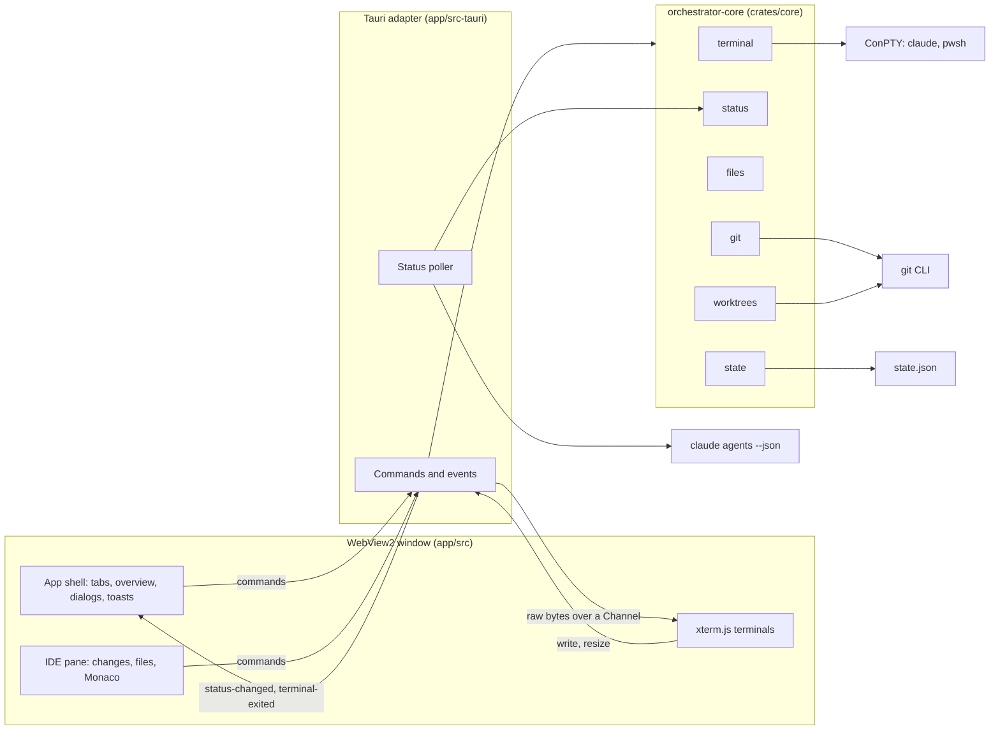

# Architecture

Agentic Orchestrator is one Windows process with a WebView2 window. The Rust backend owns every terminal, file, git and worktree operation. The web front end only draws the UI and calls the backend through Tauri commands. Nothing listens on a network port.

## Layers

| Layer | Folder | Holds | Rule |
|---|---|---|---|
| Core | `crates/core` | All logic, with tests. No Tauri dependency. | New behaviour goes here first. |
| Adapter | `app/src-tauri` | Tauri commands, events, the status poller, window setup. | Argument conversion and wiring only. |
| Front end | `app/src` | React UI. `bindings.ts` is generated from the adapter. | Never hand-write IPC types. |

## Terminals

- Each terminal is a ConPTY session created by `portable-pty`, with its process in a Windows Job Object so that killing or closing it ends the whole process tree.
- Sessions live in the backend, not the page. Output goes into a 2 MB scrollback buffer and to the attached sink. Attaching replays the scrollback, then streams live, so a tab switch or a webview reload never loses a terminal.
- Output reaches xterm.js as raw bytes over a Tauri `Channel`. The first chunk after idle is sent at once; later output is batched for up to 8 ms or 64 KB.
- Terminals start with the app's environment minus variables that belong to a parent terminal or Claude Code session (for example `NO_COLOR`, `WT_SESSION`, `CLAUDECODE`), plus `TERM` and `COLORTERM`.
- A workspace has at most one Claude terminal, started as `claude --session-id <uuid>` or `claude --resume <uuid>`, and any number of shells.

## Status

The poller runs `claude agents --json`, matches each entry to a workspace by the session id the app assigned, and feeds the result through a small state machine in `status.rs`. The front end receives one `status-changed` event when anything changes.

| Reported by Claude Code | Shown as |
|---|---|
| `busy` | Working |
| `waiting` for a permission prompt | Needs permission |
| `waiting` for anything else | Waiting for input |
| `idle` after working, tab not in view | Finished |
| `idle` | Idle |
| process running, not listed yet | Starting, then "Check terminal" (usually the folder trust prompt) |
| process exited | Exited, or Crashed for a non-zero exit code |

Claude Code can list a running session under a new id (seen when a session became `kind: "background"`). When no entry has the workspace's id, the poller uses the only entry in the workspace's folder that no other workspace claims. With none, or more than one, the session keeps its last status.

If the query fails, running sessions keep their last status and the UI marks status as unknown.

## Files and git

- Every file path from the UI is a workspace id plus a relative path. Core resolves it, follows links, and refuses anything outside the workspace folder or inside `.git`.
- Saves carry the version token from the last read. If the file changed on disk, the save is refused and the UI asks the user what to do.
- Git runs through the git CLI with argument arrays, never a shell string. User-supplied paths and refs are passed so they cannot be read as options.
- Worktrees are created beside the repo in `<repo>.worktrees\<branch>`. Removal is offered only for worktrees the app created. It lists what would be lost, removes only if that list is unchanged when the user confirms, never deletes a branch, and refuses worktrees that contain submodules or another worktree.

## State

`%LOCALAPPDATA%\AgenticOrchestrator\state.json` holds the workspace list, each workspace's Claude session id and the settings. It is written atomically. If it cannot be read at startup, the app says so and refuses to save, so the file is never overwritten by defaults.

## Security model

- No network listener. The front end can reach the backend only through the commands granted in `app/src-tauri/capabilities/default.json`.
- A strict content security policy: scripts and styles from the app only, no remote origins.
- The front end is treated as untrusted input by the backend: it names workspaces by id, and core validates every path, branch name and argument.
- Logs and notifications carry metadata only, never terminal output, file content or prompts.
